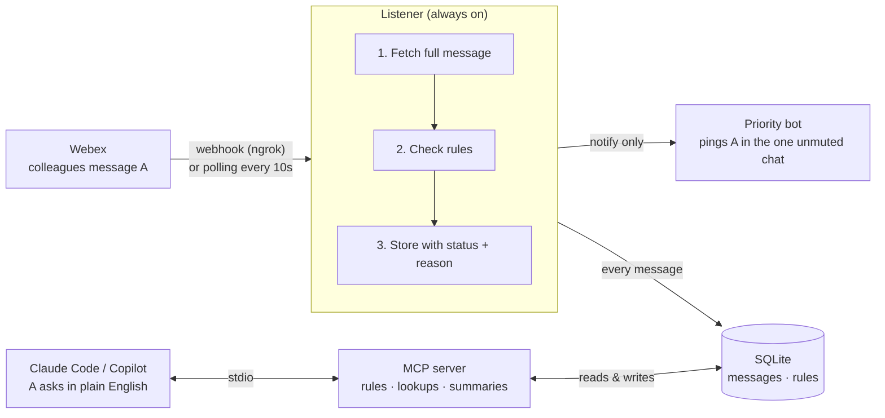

# Architecture

Two programs share one SQLite database. They never talk to each other directly.

| Piece | Code | Job |
|---|---|---|
| Listener | `listener/` | Receives new messages (webhook or polling), applies rules, stores them, triggers pings |
| Priority bot | `shared/webex_client.py` (`bot_send`) | Sends A a 1:1 message for `notify` results |
| SQLite | `data/focus.db` via `shared/db.py` | Messages with status + reason, rules, tokens, polling cursors |
| MCP server | `mcp_server/server.py` | Tools for rules, message lookups, and summaries, used from Claude Code / Copilot |

Message statuses: `notify` (pinged), `digest` (held for the summary), `ignore` (held, left out of summaries), `self` (A's own messages).

A one-page visual version for sharing is in [overview.html](overview.html).
