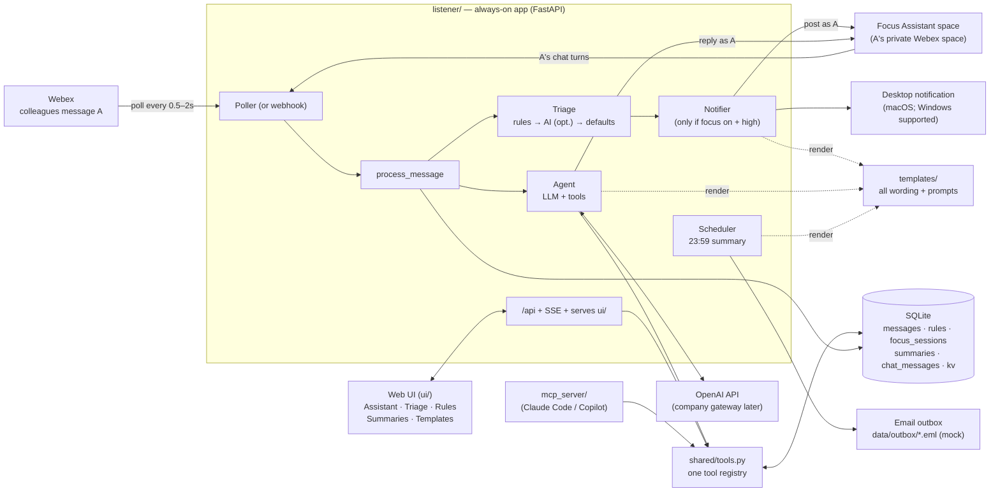

# Architecture (v2)

Two processes share one SQLite database. They never talk to each other directly.

## Pieces

| Piece | Code | Job |
|---|---|---|
| Poller / webhook | `listener/poller.py`, `listener/webhook.py` | Find new messages. Polling is the default (company network), webhook is for home. Both call `process_message` |
| Pipeline | `listener/pipeline.py` | For each message: skip our own posts. A's messages in the Focus Assistant space go to the agent. A's messages elsewhere are stored as `self`. Everything else is triaged, stored, and maybe notified |
| Triage | `shared/rules.py` (pure), `shared/triage_ai.py` (Phase 10) | Decide `high` or `regular` and record `reason` + `decided_by` |
| Focus mode | `shared/focus.py` | On/off flag and focus sessions. Turning it off triggers a session summary |
| Notifier | `shared/notifier.py`, `shared/desktop_notify.py` | `NOTIFY_CHANNELS`: `assistant_space` (integration post), `desktop` (terminal-notifier / osascript on macOS, win11toast on Windows), `bot` (home only) |
| Agent | `shared/agent.py`, `shared/llm.py` | Chat loop with tool calling. `llm.py` is the only file that talks to OpenAI |
| Tools | `shared/tools.py` | The single list of things the AI and the UI can do; see [ai-tools.md](ai-tools.md) |
| Summaries | `shared/summary.py`, `shared/emailer.py`, `listener/scheduler.py` | On demand, at focus-off, and at 23:59 (written to the email outbox) |
| Templates | `shared/templates.py` + `templates/` | Render every response; non-technical teammates edit the files |
| UI API | `listener/api.py`, `listener/events.py` | JSON endpoints and Server-Sent Events for `ui/` |
| MCP server | `mcp_server/server.py` | Exposes `shared/tools.py` to Claude Code / Copilot over stdio |

## Message categories

`high` (notify now, if focus is on) · `regular` (held for the summary) · `self` (A's own messages; context only). Every row also stores `reason` (e.g. `rule#2 sender=bob@…`, `default:mention`, `ai: reports an outage`), `decided_by` (`rule` / `default` / `ai` / `self`), and `feedback` from the Triage tab.

## Why the Focus Assistant space

On the company network the Priority bot is blocked, so we post with the **integration**, as A. Webex never notifies you about your own messages, so:
- the post in the space is the **record** (it is on every device and is where A chats with the assistant), and
- the **desktop notification** is the actual alert.

Every message we post is recorded in `app_posts`, so the poller doesn't treat our own posts as A's chat input.

## Swap points for the company repo

The hackathon repo will be rebased on this one. Everything company-specific is isolated so the move only touches these places:

| Concern | This repo (personal accounts, Mac) | Company repo later | Where to change |
|---|---|---|---|
| LLM | OpenAI API, direct, `OPENAI_API_KEY` | Company gateway (OpenAI-compatible, maybe an older model) | `.env`: `OPENAI_BASE_URL`, `OPENAI_API_KEY`, `LLM_MODEL`. Only `shared/llm.py` if the gateway needs special auth |
| Email | Outbox: `.eml` + `.html` in `data/outbox/` | SMTP or Microsoft Graph | A new backend in `shared/emailer.py` + `EMAIL_BACKEND` |
| Desktop alert | macOS (`terminal-notifier` / `osascript`) | macOS, maybe Windows (`win11toast`) | `.env`: `DESKTOP_NOTIFIER` |
| Getting messages | Polling (webhook possible at home) | Polling | `.env`: `LISTENER_MODE`, `POLL_INTERVAL` |
| Network | Direct | Proxy + TLS inspection | `.env`: `HTTPS_PROXY`, `SSL_CERT_FILE` |
| Alert channel | `assistant_space,desktop` (bot optional) | `assistant_space,desktop` | `.env`: `NOTIFY_CHANNELS` |
